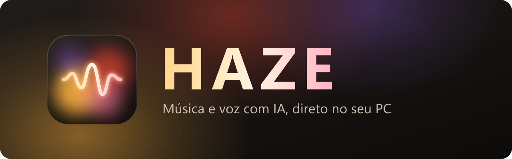
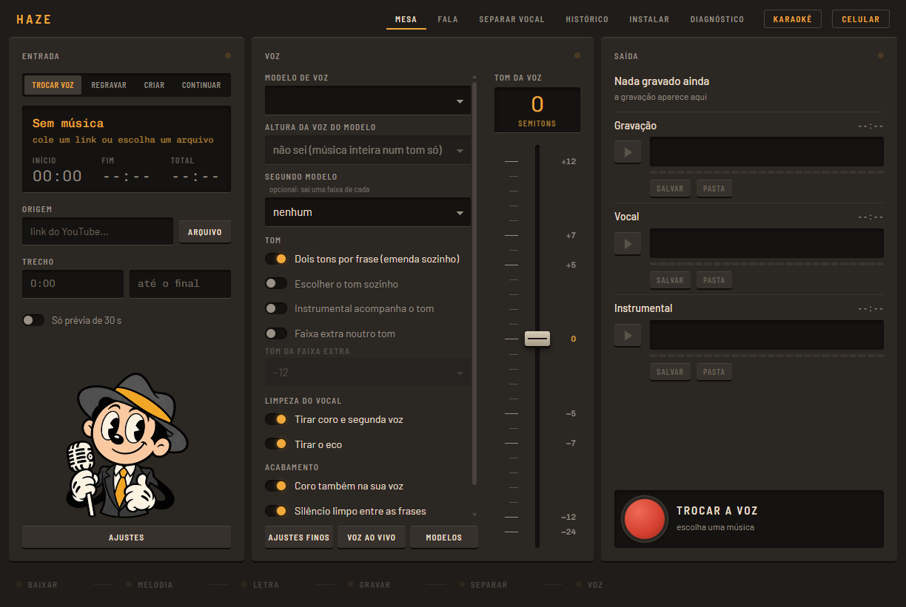
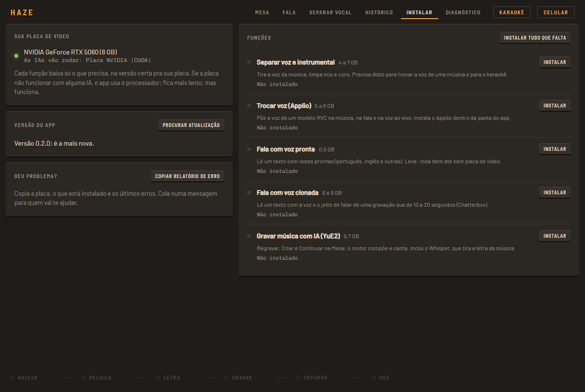

<p align="center">
  
</p>

<p align="center">
  <a href="https://github.com/inflzzz/haze/releases/latest"></a>
  
  
  
</p>

<p align="center">
  <b>Troque a voz de qualquer música, crie músicas do zero, faça seu PC falar com a sua voz e cante no karaokê com Auto-Tune.</b><br>
  Tudo roda no seu computador: sem assinatura, sem nuvem, sem mandar seus áudios pra ninguém.
</p>

<p align="center">
  
</p>

---

## ✨ O que ele faz

### 🎙️ Trocar a voz de uma música
Cole o link do YouTube e escolha um modelo de voz (RVC). O Haze separa a voz do instrumental, tira o coro e o eco e canta a música com a voz do modelo.

- **Dois tons por frase**: o verso grave e o refrão agudo saem cada um na oitava certa, emendados sozinhos
- Coro também na voz do modelo, silêncio limpo entre as frases e volume igual ao original
- Voz e instrumental saem **em faixas separadas**, prontas pro seu editor (FL Studio, Reaper…)
- Dois modelos de uma vez: sai uma faixa inteira de cada

### 🎼 Regravar, criar e continuar músicas
Com o motor **YuE2**, uma IA que compõe e canta:

- **Regravar**: a música de novo, com outra voz e outro estilo
- **Criar**: música nova a partir de um estilo e de uma letra (ou só instrumental)
- **Continuar**: começa com um trecho de música real e a IA compõe o resto
- Letra e partitura tiradas da música automaticamente (Whisper + SheetSage)

### 🗣️ Fala
Escreva um texto e ele sai falado.

- **Sua voz clonada**: clique em **● Gravar**, leia o texto que aparece por 10 a 20 segundos e ele passa a falar com a sua voz e o seu jeito (Chatterbox: inglês, português, espanhol, francês, italiano, alemão e japonês)
- **Voz pronta**: vozes leves que rodam até sem placa de vídeo (Kokoro)
- Dá pra passar a fala depois pelo seu modelo de voz

### 🎤 Karaokê
Uma tela própria: cole o link e cante.

- Letra sincronizada, que rola sozinha
- Seu microfone passa pelos seus plugins VST3, como Auto-Tune e reverb, com atraso baixo
- Régua de afinação estilo SingStar, com placar
- Mude o tom da música e o Auto-Tune acompanha

### 🔴 Voz ao vivo
O microfone entra e sai a voz do modelo, em tempo real. Com um cabo de áudio virtual, ela vai pro Discord, OBS ou jogo. Dá pra trocar de modelo sem desligar.

### 📱 Pelo celular
Abra a página do Haze no celular (QR code), grave um áudio e receba de volta com a voz trocada, pronto pra mandar no WhatsApp **como mensagem de voz**. Dá também pra pedir uma música por link ou escrever um texto pra ele falar.

### 📚 Biblioteca de modelos
Digite o nome de uma voz (tipo "marilia" ou "miku") e o Haze procura no Hugging Face. Ele mostra só os modelos prontos pro Applio, com botão de baixar. Também dá pra colar links. Organize em pastas, por língua e favoritos, dê apelidos e ouça uma amostra ▶ de cada um.

### ✂️ Separar vocal e instrumentos
- **Voz e instrumental**, com os mesmos modelos do UVR5 (MDX-Net e Mel-Band RoFormer)
- **Por instrumento**: voz, bateria, baixo, guitarra, piano e o resto, cada um numa faixa (Demucs). Arraste todas de uma vez pro FL Studio

### 🎹 Melodia e acordes em MIDI
Um clique tira a melodia da voz e os acordes do instrumental num `.mid`, já no andamento da música. Arraste o botão direto pro FL Studio: sai uma faixa pra melodia e outra pros acordes.

### 🔄 Sempre atualizado
O Haze avisa quando sai uma versão nova e se atualiza com um clique, sem apagar as IAs instaladas, os seus ajustes nem as suas músicas. Deu algum problema? O botão **Copiar relatório de erro** junta a placa, o que está instalado e os últimos erros, pronto pra colar numa mensagem.

---

## 📥 Como instalar

1. Baixe o **`Haze-instalador.zip`** na [página de downloads](https://github.com/inflzzz/haze/releases/latest) (~350 MB).
2. **Extraia o .zip antes**: clique com o botão direito nele e escolha **Extrair tudo…**. Depois abra a pasta extraída e dê dois cliques em **`Instalar Haze.cmd`**. Rodar direto de dentro do .zip não funciona.
3. O Haze abre na aba **Instalar**. Escolha só as funções que você vai usar: cada uma baixa o que precisa.

<p align="center">
  
</p>

O app **descobre sua placa de vídeo sozinho** e baixa a versão certa de cada IA. Se a placa não funcionar com alguma delas, ele testa e passa pro processador. Fica mais lento, mas funciona.

| Sua placa | Como as IAs rodam |
|---|---|
| **NVIDIA** RTX 50 | Na placa (CUDA 12.8) |
| **NVIDIA** GTX 10 / RTX 20 / 30 / 40 | Na placa (CUDA 12.6) |
| **AMD** RX 7000 · RX 9000 · Radeon 780M | Na placa (ROCm da AMD, versão de teste) |
| Outras placas ou sem placa | No processador |

O motor de música (YuE2) roda em qualquer placa com Vulkan: NVIDIA, AMD ou Intel.

### Quanto espaço cada função ocupa

| Função | Tamanho |
|---|---|
| Separar voz e instrumental | 4 a 7 GB |
| Trocar voz (Applio) | 5 a 8 GB |
| Fala com voz pronta | 0,5 GB |
| Fala com voz clonada | 6 a 9 GB |
| Gravar música com IA (YuE2) | 5,7 GB |

**Recomendado:** Windows 10 ou 11, 16 GB de RAM, placa de vídeo com 8 GB e um SSD.

---

## 🛠️ Para quem quer mexer no código

O app é feito em [Electron](https://www.electronjs.org/). As IAs rodam em ambientes Python separados, criados pelo [uv](https://github.com/astral-sh/uv). Comece por estes arquivos:

| Arquivo | O que é |
|---|---|
| `app/src/pipeline.js` | Todas as etapas: baixar, separar, trocar a voz, gravar |
| `app/src/componentes.js` | Instalação por partes e detecção da placa |
| `app/renderer/` | A interface |
| `instalador/empacotar.ps1` | Monta o `Haze-instalador.zip` |
| `build-engine-*.cmd` | Compilam o motor YuE2 (CUDA ou Vulkan) e o Whisper |

```bash
cd app
npm install
npm start
```

---

## ⚠️ Use com responsabilidade

Clonar e trocar voz é divertido, mas só use a voz de alguém **com a permissão dessa pessoa**. Não use pra enganar, se passar por outra pessoa ou pra conteúdo que viole direitos autorais. Os modelos de IA têm licenças próprias: confira antes de usar o que você criar comercialmente.

## 🙏 Feito em cima de

[YuE](https://github.com/multimodal-art-projection/YuE) e [yue2.cpp](https://github.com/ServeurpersoCom/yue2.cpp) ·
[Applio](https://github.com/IAHispano/Applio) ·
[python-audio-separator](https://github.com/nomadkaraoke/python-audio-separator) (modelos do UVR) ·
[Chatterbox](https://github.com/resemble-ai/chatterbox) ·
[Kokoro](https://huggingface.co/hexgrad/Kokoro-82M) via [kokoro-onnx](https://github.com/thewh1teagle/kokoro-onnx) ·
[whisper.cpp](https://github.com/ggml-org/whisper.cpp) ·
[pedalboard](https://github.com/spotify/pedalboard) ·
[LRCLIB](https://lrclib.net) ·
[yt-dlp](https://github.com/yt-dlp/yt-dlp) ·
[FFmpeg](https://ffmpeg.org)

<p align="center"><sub>Licença MIT · feito por <a href="https://github.com/inflzzz">inflzzz</a></sub></p>
